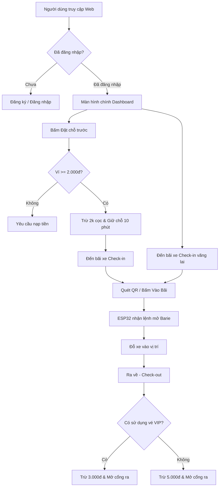

# 🚗 Hệ Thống Bãi Đỗ Xe Thông Minh (Smart Parking IoT System)


Hệ thống quản lý bãi đỗ xe thông minh tích hợp giữa **Trạm phần cứng điều khiển vi xử lý ESP32** và **Giao diện Web App quản lý thời gian thực** (Real-time Web App). Hệ thống hỗ trợ đặt chỗ trước (giữ chỗ), tự động trừ cọc, quét mã QR vào/ra bãi và tính phí linh hoạt dựa trên loại vé.

---

## 🌟 Tính Năng Nổi Bật

### 📱 Giao Diện Web App & Xử Lý Logic (Client & Cloud)
* **Xác thực người dùng & Ví tiền:** Đăng ký/Đăng nhập bằng Firebase Auth, nạp tiền linh hoạt vào ví cá nhân.
* **Theo dõi trạng thái Realtime:** Cập nhật ngay lập tức tình trạng trống/đã đặt/đã đỗ của từng ô đỗ xe thông qua Firebase Realtime Database.
* **Đặt chỗ trước (Vé VIP):**
  * Đặt cọc trước **2.000đ** trực tiếp vào ví.
  * Bộ đếm ngầm **tự động hủy chỗ sau 10 phút** (Timeout) nếu tài xế chưa check-in.
  * **Chặn đặt trùng:** Rào chắn bảo mật giới hạn mỗi tài khoản chỉ được đặt tối đa **1 chỗ đỗ** tại một thời điểm để tránh xung đột dữ liệu.
* **Cơ chế tính phí thông minh (Differentiated Pricing):**
  * **Khách VIP (Đã đặt trước):** Check-in bằng vé VIP -> Check-out chỉ trừ nốt **3.000đ** còn lại.
  * **Khách Vãng lai (Chưa đặt trước):** Check-in tự do -> Check-out thanh toán đủ **5.000đ**.
* **Tích hợp Mã QR:** Tự động tạo mã QR Check-in/Check-out hỗ trợ thao tác nhanh qua camera điện thoại.

### 🔌 Trạm Phần Cứng (ESP32 Hardware)
* **Cổng vào/ra tự động:** Sử dụng động cơ Servo mô phỏng Barie, đóng/mở dựa trên lệnh `entry_cmd` và `exit_cmd` từ Firebase.
* **Cảm biến vị trí:** Đọc trạng thái ô đỗ bằng cảm biến hồng ngoại IR/Siêu âm và đồng bộ liên tục lên đám mây.

---

## 📁 Cấu Trúc Thư Mục Dự Án

```text
smart-parking-iot/
├── esp32/                  # Mã nguồn C++/Arduino cho trạm điều khiển
│   ├── esp1.ino            # Điều khiển Barie cổng vào & Cảm biến ô đỗ 1, 2
│   └── esp2.ino            # Điều khiển Barie cổng ra & Cảm biến ô đỗ 3, 4
├── web/                    # Giao diện Web App tương tác người dùng
│   └── index.html          # Mã nguồn Frontend (HTML5, Tailwind CSS, JS, Firebase)
├── docs/                   # Sơ đồ nguyên lý mạch, báo cáo & hình ảnh mô hình
├── .gitignore              # Chặn các file rác (.vercel, build, binary files)
└── README.md               # Tài liệu hướng dẫn dự án
```

---

## 🛠️ Công Nghệ Sử Dụng

* **Frontend:** HTML5, [Tailwind CSS](https://tailwindcss.com/), JavaScript (ES6+), QRCode.js, FontAwesome.
* **Backend & Database:** [Firebase Realtime Database](https://firebase.google.com/), Firebase Authentication.
* **Hardware:** Microcontroller ESP32, Servo SG90, Cảm biến IR (Infrared Sensor) / HC-SR04.
* **Hosting & CI/CD:** [Vercel](https://vercel.com/) (Web Hosting), [GitHub](https://github.com/) (Version Control).

---

## 🔄 Luồng Hoạt Động Hệ Thống (Workflow)



---

## ⚡ Hướng Dẫn Cài Đặt & Triển Khai

### 1. Cấu hình Firebase
1. Tạo một project mới trên [Firebase Console](https://console.firebase.google.com/).
2. Bật dịch vụ **Authentication** (Phương thức Email/Password).
3. Tạo **Realtime Database** và cấu hình `Rules` đọc/ghi:
   ```json
   {
     "rules": {
       ".read": true,
       ".write": true
     }
   }
   ```
4. Copy thông số `firebaseConfig` và dán vào file `web/index.html`.

### 2. Nạp Code cho ESP32
1. Mở các file trong thư mục `esp32/` bằng **Arduino IDE** hoặc **VS Code (PlatformIO)**.
2. Tải các thư viện cần thiết: `WiFi.h`, `FirebaseESP32`.
3. Điền thông tin `WIFI_SSID`, `WIFI_PASSWORD` và `FIREBASE_HOST`, `FIREBASE_AUTH` vào file `.ino`.
4. Biên dịch và nạp code lên board ESP32.

### 3. Deploy Web lên Vercel
 Mở Terminal tại thư mục gốc dự án và chạy các lệnh:
```bash
# Cài đặt Vercel CLI (nếu chưa có)
npm install -g vercel

# Tiến hành deploy bản chính thức
npx vercel --prod
```

---

## 👤 Tác Giả

* **Hoàng BH** - *Developer & Hardware Engineer*
* **GitHub:** [@HoangBH28](https://github.com/HoangBH28)

---
*Dự án phục vụ mục đích học tập và nghiên cứu ứng dụng IoT trong đô thị thông minh.*